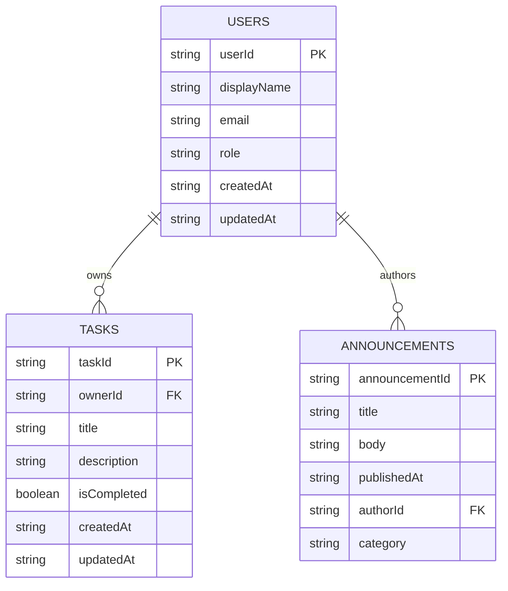

# Week 9 - CampusConnect Database Concepts and Data Modeling

## 1. Database Concepts

### Relational database
A relational database stores data in related tables with rows and columns. Relationships are commonly enforced with primary and foreign keys. SQL databases such as PostgreSQL or MySQL are common examples.

### NoSQL database
A NoSQL database stores data in formats such as documents, key-value pairs, columns, or graphs. A document database may store a user and nested preferences without requiring fixed table columns.

### Primary key
A primary key uniquely identifies each record in a table. CampusConnect examples are `USERS.userId`, `TASKS.taskId`, and `ANNOUNCEMENTS.announcementId`.

### Foreign key
A foreign key references a primary key in another table or collection. `TASKS.ownerId` references `USERS.userId`, and `ANNOUNCEMENTS.authorId` references `USERS.userId`.

### CRUD
CRUD means Create, Read, Update, and Delete. These are basic operations for adding, viewing, changing, and removing records.

### CRUD and HTTP methods
CRUD describes the data operation. HTTP methods describe the request to a server: POST creates, GET reads, PUT or PATCH updates, and DELETE removes. They are related but not identical: for example, GET should not be used to change database data.

### Local storage
Local storage keeps data on the user's device. It can support offline use and fast access, but it is limited to that device unless synchronized.

### Cloud storage
Cloud storage keeps shared data on a remote service. It enables synchronization across devices and centralized backup, but it requires network access and correct security rules.

### Hybrid storage
Hybrid storage combines local persistence with a cloud source of truth. CampusConnect could display cached tasks offline and synchronize them when the device reconnects.

## 2. Data Dictionary

The existing app currently uses `Announcement`, `InteractiveAnnouncement`, `ApiPost`, and `StudentProfile`. Week 9 adds design fields and models for future implementation. `ApiPost` belongs to JSONPlaceholder demonstration data and is not an implemented campus database record.

### USERS

| Field | Data Type | Required | Description |
|---|---|---|---|
| `userId` | string | Required | Primary key for the user. |
| `displayName` | string | Required | Name displayed in the application. |
| `email` | string | Required | User's login or contact email. |
| `role` | string | Required | User role, such as student or administrator. |
| `createdAt` | string | Required | ISO 8601 timestamp for account creation. |
| `updatedAt` | string | Required | ISO 8601 timestamp for the latest account update. |

### TASKS

| Field | Data Type | Required | Description |
|---|---|---|---|
| `taskId` | string | Required | Primary key for the task. |
| `ownerId` | string | Required | Foreign key referencing `USERS.userId`. |
| `title` | string | Required | Short task title. |
| `description` | string | Optional | Additional task details. |
| `isCompleted` | boolean | Required | Whether the task is complete. |
| `createdAt` | string | Required | ISO 8601 task creation timestamp. |
| `updatedAt` | string | Required | ISO 8601 timestamp for the latest task update. |

### ANNOUNCEMENTS

| Field | Data Type | Required | Description |
|---|---|---|---|
| `announcementId` | string | Optional in current model / Required in proposed design | Primary key for a CampusConnect announcement. |
| `title` | string | Required | Announcement title. |
| `body` | string | Optional in current model / Required in proposed design | Full announcement content. |
| `publishedAt` | string | Optional in proposed model | ISO 8601 publication timestamp. |
| `authorId` | string | Optional in proposed model | Foreign key referencing `USERS.userId`. |
| `category` | string or existing category union | Optional | Announcement category such as Academic or Events. |

The existing `Announcement` model also has app-facing fields: numeric `id`, `message`, `date`, `isPinned`, and `read`. `announcementId`, `body`, `publishedAt`, and `authorId` are design-compatible additions. Existing `InteractiveAnnouncement` and Week 8 `ApiPost` remain separate from the permanent data model.

## 3. Entity Relationships

- One User can own many Tasks.
- One User can author many Announcements.
- Each Task belongs to exactly one User.
- Each Announcement references exactly one author.
- `TASKS.ownerId` is a foreign key to `USERS.userId`.
- `ANNOUNCEMENTS.authorId` is a foreign key to `USERS.userId`.

## 4. CRUD Mapping

| CRUD Operation | CampusConnect Action | HTTP Method | Description |
|---|---|---|---|
| Create | Create a task | POST | Add a new task record. |
| Read | View tasks or announcements | GET | Retrieve and display records. |
| Update | Edit a task or mark it complete | PUT/PATCH | Replace or partially modify task fields. |
| Delete | Delete a task | DELETE | Remove the task after confirmation. |

CRUD describes what happens to data, while HTTP methods describe how a client communicates a requested operation to an API.

## 5. Storage Decision

CampusConnect should use a hybrid storage approach. A local database or persistent key-value store would keep tasks accessible when the device is offline and provide a responsive interface. A cloud database would act as the shared source of truth for tasks and announcements across devices. The cloud data model should preserve foreign-key relationships or enforce equivalent ownership and author references. Synchronization must record pending local changes and reconcile them after connectivity returns. Security rules should verify the authenticated user's access to each task. This approach balances offline reliability, cross-device consistency, and authorization. No database or cloud synchronization is currently implemented in the project.

## 6. CRUD Process Explanation

1. A user creates a task by entering a title and optional description and submitting a validated form. The app generates a task ID, stores the owner's user ID, and sets timestamps.
2. The app reads tasks for the signed-in owner and displays them in a list. The read operation should filter by `ownerId`, unless an administrator is permitted to view more.
3. Editing changes fields and writes a new `updatedAt` timestamp. Marking a task complete also updates `isCompleted` and `updatedAt`.
4. Deletion should ask the user to confirm. After successful deletion, the app removes the record from local/cloud storage and the displayed list.

## 7. Offline and Security Considerations

If a task is edited while offline, the app can store the change locally and mark it pending synchronization. The app should queue the update and send it after connectivity returns, preferably with a retry strategy. If two devices edit the same task, conflict resolution is needed. A last-write-wins policy is simple, while a version or timestamp policy can prevent overwriting recent changes. The app should authenticate users and enforce authorization for task creation, reading, editing, and deletion. Sensitive values should use HTTPS and server-side security rules. Privileged database credentials must never be embedded in a mobile app because users can inspect app binaries or network configuration. Cloud credentials must be restricted and exposed only through secure server or platform authentication mechanisms.

## 8. Exercise Answers

### Exercise 1 - Concepts

13. Relational databases enforce structured tables and relationships, while NoSQL databases commonly store flexible document structures.
14. CRUD describes storage operations, while HTTP methods describe API request semantics.
15. A primary key uniquely identifies a record; a foreign key identifies a record owned or authored in another entity.
16. Local storage supports offline use and fast retrieval. Cloud storage provides cross-device synchronization and centralized backup.
17. Hybrid storage allows CampusConnect to remain usable offline while synchronizing shared records to the cloud.

### Exercise 2 - Data Modeling

18. The data dictionary above covers USERS, TASKS, and ANNOUNCEMENTS.
19. Field types and required/optional status are listed for every field.
20. Users own Tasks and author Announcements. Tasks reference one owner, and Announcements reference one author.
21. `data/sampleTask.json` contains one valid task record.
22. CampusConnect should use a hybrid local/cloud approach. It needs relationships, offline access, synchronization, security, and shared consistency. Local persistence improves responsiveness and offline reliability, while cloud storage acts as the source of truth. Platform security rules and authenticated APIs should restrict access. Conflict handling and retry queues should be included for synchronization. This choice is not yet implemented by the current project.

### Exercise 3 - Reflection

Clear database structure makes CampusConnect easier to understand and reduces conflicting or duplicated data. CRUD operations define predictable actions for creating, reading, editing, and deleting records. Consistent primary and foreign keys keep tasks and announcements connected to the correct users. Local persistence improves offline reliability and allows fast access to recent information. Cloud synchronization keeps changes consistent across multiple devices. A hybrid approach requires careful conflict handling and authorization. Together, these choices improve the application's reliability and user experience.

### Knowledge Check

23. A relational database benefit is consistent structure and strong support for relationships between records.
24. A foreign key represents a reference from one record to a primary key in another entity.
25. NoSQL still requires a data model so fields, relationships, validation, and application queries remain understandable.
26. Local persistence survives app restarts or process termination, while component state exists only while that component remains mounted.
27. Two synchronization concerns are conflicting edits from multiple devices and preserving offline changes until network connectivity returns.
